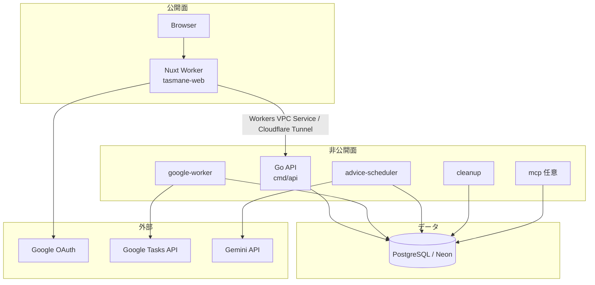
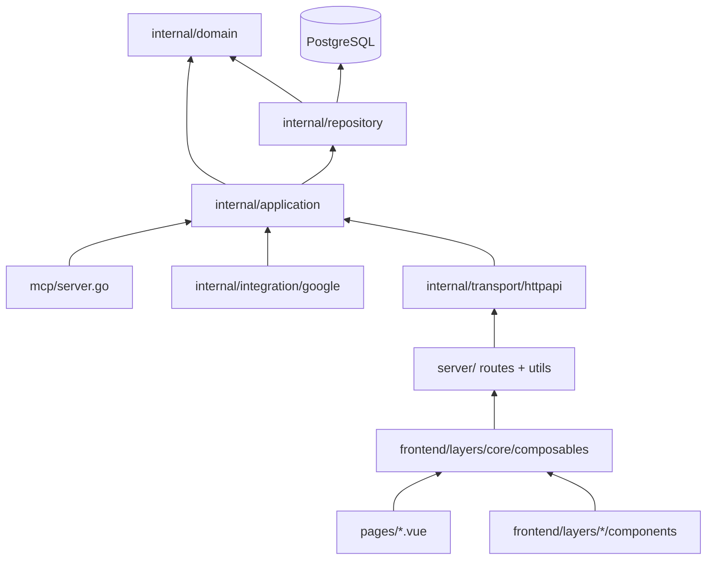
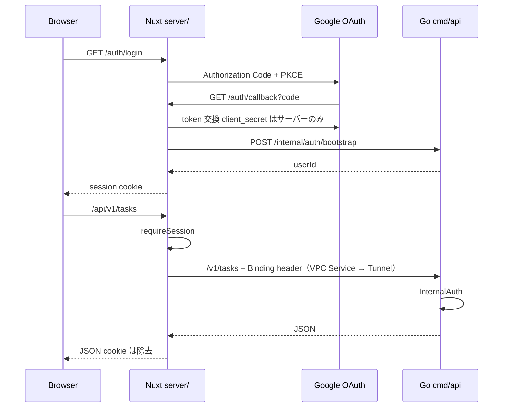
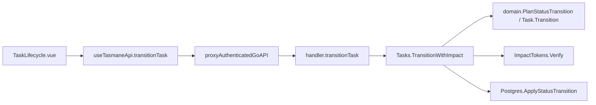
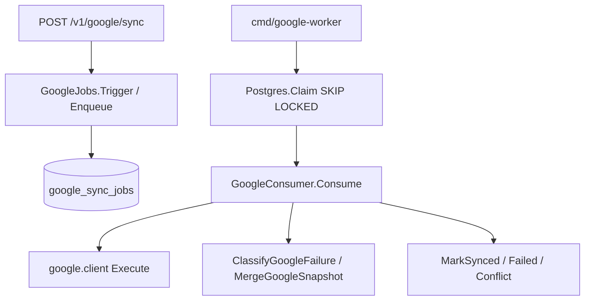
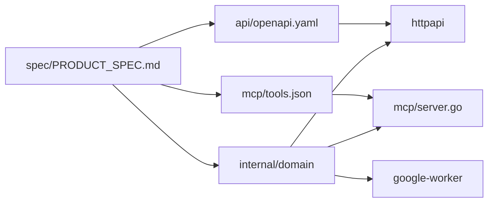

# タスマネ ファイル・関数相関

正本仕様: `spec/PRODUCT_SPEC.md`  
HTML版: `docs/architecture.html`

コメント規則（ソース）: 体言止め・1文・文末「。」なし

---

## 1. 全体像

Browser は Nuxt Worker のみに到達する。業務 API の本体は Go。MCP は任意の別入口。

---

## 2. ランタイムプロセス

| プロセス | 入口ファイル | 役割 |
|---|---|---|
| tasmane-web | `nuxt.config.ts` / `cloudflare.config.ts` / `wrangler.config.ts` | 公開 UI・OAuth・Go への proxy・WebMCP |
| tasmane-api | `cmd/api/main.go` / `docker-compose.prod.yml` | 自宅サーバーの Go API（Tunnel 経由のみ） |
| cloudflared | `docker-compose.prod.yml` | Cloudflare Tunnel コネクタ（外向き接続のみ） |
| google-worker | `cmd/google-worker/main.go` | Google Tasks 同期 consumer |
| advice-scheduler | `cmd/advice-scheduler/main.go` | ユーザーTZ 04:00 以降の Advice 生成 |
| cleanup | `cmd/cleanup/main.go` | soft-delete 30日後の hard delete |
| migrate | `cmd/migrate/main.go` / `db/migrate.go` | 埋め込み SQL の適用 |
| mcp | `cmd/mcp/main.go` | stdin/stdout MCP。Web 非依存 |

---

## 3. 層依存

Domain 規則は Transport に置かない。HTTP / MCP / Google 同期は同じ application / domain を共有する。

---

## 4. 認証と API 転送

相関:

- `server/routes/auth/login.get.ts` → `server/utils/auth.ts` / `oauth.ts` / `config.ts`
- `server/routes/auth/callback.get.ts` → `verifyGoogleIDToken` → `fetchGoAPI` → `httpapi` の bootstrap
- `server/routes/api/v1/[...path].ts` → `proxyAuthenticatedGoAPI` → `trustedProxyHeaders` → `cmd/api`
- `server/utils/upstream.ts` の `TASMANE_API`（Workers VPC Service）、無ければ `NUXT_API_INTERNAL_URL`（loopback のみ）

---

## 5. ディレクトリとファイル

### 5.1 公開 Worker / UI

| ファイル | 役割 |
|---|---|
| `nuxt.config.ts` | Nuxt 層・runtimeConfig・Cloudflare preset |
| `pages/index.vue` | トップ。次タスクと Fire 件数 |
| `pages/dashboard.vue` | Dashboard 入口 |
| `pages/dashboard/genres/[genreId].vue` | Genre 別 Dashboard |
| `pages/tasks/[taskId].vue` | タスク詳細 |
| `pages/tasks/new.vue` | 新規作成 |
| `pages/genres.vue` | Genre 一覧 |
| `pages/search.vue` | 検索 |
| `pages/settings.vue` | timezone / sync 間隔 |
| `frontend/layers/core/composables/useCriticalData.ts` | 重要データ取得と `useTasmaneApi` |
| `frontend/layers/core/composables/criticalOrder.ts` | 描画後 prefetch |
| `frontend/layers/core/composables/impact.ts` | Impact 確認文面 |
| `frontend/layers/core/composables/taskState.ts` | 検索状態と deadline 区分 |
| `frontend/layers/core/composables/useEntityChannel.ts` | エンティティ版数の適用 |
| `frontend/layers/shared/components/AppHeader.vue` | ヘッダ |
| `frontend/layers/shared/components/AppSidebar.vue` | サイドバー |
| `frontend/layers/shared/components/ImpactModal.vue` | Impact 確認モーダル |
| `frontend/layers/dashboard/components/DashboardView.vue` | Dashboard 本体 |
| `frontend/layers/dashboard/components/GanttEditor.vue` | 期間ドラッグ編集 |
| `frontend/layers/task/components/TaskEditor.vue` | タスク編集フォーム |
| `frontend/layers/task/components/TaskLifecycle.vue` | 状態遷移 UI |
| `frontend/layers/task/components/HierarchyTree.vue` | 親子ツリー |
| `frontend/layers/task/components/DependencyGraph.vue` | 依存グラフ |
| `assets/css/main.css` | 共通スタイル |
| `server/middleware/security.ts` | CSP 等の応答ヘッダ |
| `server/utils/security.ts` | cookie seal / PKCE 用ハッシュ |
| `server/utils/auth.ts` | session / OAuth transaction cookie |
| `server/utils/oauth.ts` | Google ID token 検証 |
| `server/utils/config.ts` | 認証 runtimeConfig の必須チェック |
| `server/utils/upstream.ts` | VPC Service 経由の Go 到達と Binding ヘッダ浄化 |
| `server/utils/proxyGo.ts` | session・同一 Origin 検証後の Go proxy |
| `server/routes/auth/*.ts` | login / callback / logout / session |
| `server/routes/api/v1/[...path].ts` | `/api/v1` → `/v1` へ rewrite |
| `cloudflare.config.ts` | cf 用 Worker 定義（VPC Service binding・Secret 宣言・ドメイン） |
| `wrangler.config.ts` | cf の Wrangler bundler 設定（アセット出力先） |
| `scripts/cf-build.sh` | nuxt build → Build Output 生成 |
| `frontend/layers/core/plugins/webmcp.client.ts` | WebMCP Tool 登録 |

### 5.2 Go API

| ファイル | 役割 |
|---|---|
| `cmd/api/main.go` | env・migrate・router・graceful shutdown |
| `internal/transport/httpapi/handler.go` | `/v1` ルートと CRUD ハンドラ |
| `internal/transport/httpapi/auth.go` | Binding secret と userId 注入 |
| `internal/transport/httpapi/auth_bootstrap.go` | Google ユーザー upsert と refresh token 暗号化保存 |
| `internal/transport/httpapi/task_handlers.go` | タスク操作（TaskCommands 呼び出し） |
| `internal/transport/httpapi/task_update.go` | PATCH 入力の適用 |
| `internal/transport/httpapi/dashboard_projection.go` | 確認事項の推薦投影 |
| `internal/application/task_commands.go` | Impact Plan 付きタスク操作（HTTP/MCP 共通） |
| `internal/application/projection.go` / `internal/domain/projection.go` | 進捗・実効優先度・炎・TaskScore の共通投影 |
| `internal/transport/httpapi/google.go` | sync / conflicts / import-candidates |
| `internal/transport/httpapi/health.go` | healthz / readyz |
| `internal/application/tasks.go` | 所有権付き Task ユースケース |
| `internal/application/catalog.go` | Genre / TaskType |
| `internal/application/relations.go` | 親子・依存・Confirmation |
| `internal/application/settings.go` | ユーザー設定 |
| `internal/application/impact.go` | Impact token の発行と検証 |
| `internal/application/google_sync.go` | queue 投入と consumer |
| `internal/application/advice.go` | Advice 取得・生成・期限切れ削除 |
| `internal/application/advice_scheduler.go` | 全ユーザーの日次判定 |
| `internal/application/cleanup.go` | 期限切れ Task の hard delete |
| `internal/domain/task.go` | FSM・作成検証・親進捗 |
| `internal/domain/status_transition.go` | 祖先/子孫を含む遷移計画 |
| `internal/domain/graph.go` | 階層と依存の閉路検査 |
| `internal/domain/impact.go` | Genre 移動と削除の影響範囲 |
| `internal/domain/date_propagation.go` | 日付変更の伝播 |
| `internal/domain/deadline.go` | overdue / fire 投影 |
| `internal/domain/scoring.go` | 優先度とタスクスコア |
| `internal/domain/confirmation.go` | Confirmation FSM と点数 |
| `internal/domain/advice.go` | 04:00 生成判定 |
| `internal/domain/google_sync.go` | Google 失敗分類と snapshot merge |
| `internal/domain/google_policy.go` | due 変更と専用 Task List |
| `internal/domain/settings.go` | timezone / interval 検証 |
| `internal/domain/catalog.go` | Genre / TaskType 名検証 |
| `internal/identifier/uuidv7.go` | UUIDv7 生成 |
| `internal/repository/postgres.go` | Get / UpdateStatus / 履歴 |
| `internal/repository/task_create.go` | 作成と葉→親変換 |
| `internal/repository/task_update.go` | 更新・Genre 移動の再検証 |
| `internal/repository/task_delete.go` | 削除計画と soft-delete |
| `internal/repository/task_read.go` | 検索とツリー |
| `internal/repository/status_transition.go` | 遷移 preview / apply |
| `internal/repository/relations.go` | グラフロック下の親子・依存 |
| `internal/repository/catalog.go` | Genre / TaskType 永続化 |
| `internal/repository/confirmation.go` | Confirmation 永続化 |
| `internal/repository/settings.go` | 設定永続化 |
| `internal/repository/google.go` | queue / lock / conflict / sync 行 |
| `internal/repository/google_uncomplete.go` | Google 起点の未完了戻し |
| `internal/repository/advice.go` | Advice 永続化 |
| `internal/repository/memory.go` | テスト用メモリ実装 |
| `internal/integration/google/client.go` | Tasks API 実行 |
| `internal/integration/google/token.go` | AES-256-GCM と refresh |
| `internal/integration/gemini/client.go` | Advice 生成プロンプト |
| `db/migrate.go` | 埋め込み migration の逐次適用 |
| `db/migrations/0001_init.sql` | 初期スキーマ |
| `db/migrations/0002_lifecycle_policies.sql` | ライフサイクル制約 |
| `db/migrations/0003_uuid_v7_variant.sql` | UUIDv7 変種 |
| `db/migrations/0004_google_import_candidates.sql` | import candidate |
| `db/migrations/0005_google_sync_jobs.sql` | sync job |
| `db/migrations/0006_advice_source_dedup.sql` | Advice ハッシュ重複排除 |
| `db/migrations/0007_google_job_leases.sql` | SKIP LOCKED lease |

### 5.3 周辺プロセス / 契約 / 検証

| ファイル | 役割 |
|---|---|
| `cmd/google-worker/main.go` | queue claim ループ |
| `cmd/advice-scheduler/main.go` | 日次 Advice |
| `cmd/cleanup/main.go` | hard delete |
| `cmd/migrate/main.go` | migrate 専用 |
| `cmd/mcp/main.go` | MCP 入口。`TASMANE_MCP_USER_ID` 固定 |
| `mcp/server.go` | tools.json と application の接続 |
| `mcp/tools.json` | MCP ツール契約。DELETE 非公開 |
| `api/openapi.yaml` | HTTP 契約 |
| `queue/google-sync-message.schema.json` | 同期メッセージ形 |
| `broadcast/message.schema.json` | エンティティ通知形 |
| `scripts/*.sh` | bootstrap / verify / deploy / secrets |
| `scripts/validate_contracts.py` | OpenAPI と MCP の突合 |
| `docker-compose.prod.yml` | 私有 Go スタック |
| `Dockerfile` | api / worker / scheduler / cleanup / migrate |
| `.github/workflows/verify.yml` | PR ゲート |
| `.github/workflows/deploy-api.yaml` | tasmane-api デプロイ |

テストファイルは対応する実装の契約固定。`*_test.go` / `frontend/tests/*` / `test/*.py`。

---

## 6. 関数相関（機能別）

### 6.1 タスク状態遷移

| 段階 | 関数 |
|---|---|
| UI | `TaskLifecycle` → `useTasmaneApi().transitionTask` |
| Gateway | `proxyAuthenticatedGoAPI` → `InternalAuth` |
| HTTP | `Handler.transitionTask` |
| UseCase | `Tasks.PreviewTransition` / `Tasks.TransitionWithImpact` / `Tasks.Transition` |
| Domain | `PlanStatusTransition` / `Task.Transition` / `ParentProgress` |
| Token | `ImpactTokens.Issue` / `Verify` |
| Persist | `PreviewStatusTransition` / `ApplyStatusTransition` / `UpdateStatus` |

### 6.2 タスク作成・更新・削除

| 操作 | UI | HTTP | UseCase | Domain | Persist |
|---|---|---|---|---|---|
| 作成 | `TaskEditor` / `pages/tasks/new.vue` | `createTask` | `Tasks.Create` | `NewTask` / `PlanFirstChildAddition` | `Postgres.Create` |
| 更新 | `TaskEditor` / `GanttEditor` | `updateTask` | `Tasks.Update` | `ValidateTaskDraft` / `PlanDateChange` / `PlanGenreMove` | `Postgres.Update` |
| 削除 | `TaskLifecycle` | `deleteTask` | `Tasks.Delete` | `PlanTaskDeletion` | `Postgres.DeleteTask` |
| 取得 | `pages/tasks/[taskId].vue` | `getTask` | `Tasks.Get` | 投影は HTTP | `Postgres.Get` |
| 検索 | `pages/search.vue` | `searchTasks` | `Tasks.Search` | `TaskSearch` | `Postgres.Search` |
| ツリー | `HierarchyTree.vue` | `getTaskTree` | `Tasks.Tree` | — | `Postgres.Tree` |

### 6.3 カタログ / 関係 / 確認

| 機能 | HTTP | UseCase | Domain | Persist |
|---|---|---|---|---|
| Genre | `listGenres` ほか | `Catalog.*` | `catalog.go` | `repository/catalog.go` |
| 依存 | `addDependency` ほか | `Relations.*` | `ValidateDependencyAddition` | `relations.go` |
| Confirmation | `createConfirmation` ほか | `Confirmations.*` | `Confirmation.Transition` | `confirmation.go` |
| 設定 | `getSettings` / `updateSettings` | `Settings.*` | `settings.go` | `settings.go` |

### 6.4 Dashboard

`pages/dashboard.vue` → `DashboardView` → `useTasmaneApi().dashboard` → `Handler.getDashboard` → `writeDashboard` → `dashboard_projection.go`（`CalculateTaskScore` / `ProjectDeadlineState` / `Advices.Current`）

### 6.5 Google 同期

ログイン時: `callback.get.ts` → `auth_bootstrap.go` → `token.go` で refresh token 暗号化。

### 6.6 Advice

`AdviceScheduler.RunOnce` → `ShouldGenerateAdvice` → `Advices.Generate` → `gemini.client` → `SaveAdvice`（source hash で重複排除）  
Dashboard は `Advices.Current` のみ。

### 6.7 MCP（任意）

`cmd/mcp` → `mcp.Server.Handle` → 同じ `application.Tasks` 等。`tools.json` に delete なし。ユーザーは `TASMANE_MCP_USER_ID`。

---

## 7. 契約ファイルの位置

`scripts/validate_contracts.py` が OpenAPI と MCP の欠落・DELETE 公開を検査する。

---

## 8. デプロイ相関

- Web: `scripts/deploy-worker.sh` → `scripts/cf-build.sh` → `cf deploy --prebuilt`（`cloudflare.config.ts`）/ `.github/workflows/deploy-web.yml`
- 自宅サーバー: `scripts/deploy-go.sh` → `docker-compose.prod.yml`（api・cloudflared・workers）
- Cloudflare 初期設定: `scripts/setup-cloudflare.sh`（`cf tunnels` / `cf workers-vpc services`）

---

## 9. 触らない生成物

- `.cloudflare/` — cf の Build Output
- `node_modules/` / `.nuxt/` / `.output/`
- `.env` — 秘密情報
